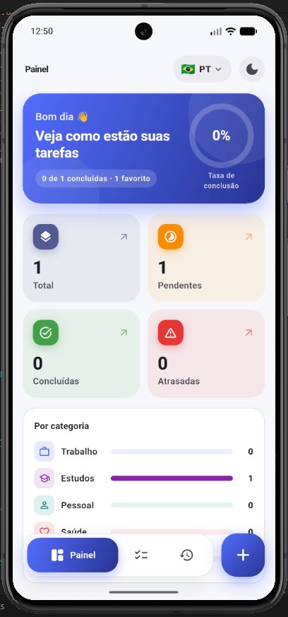
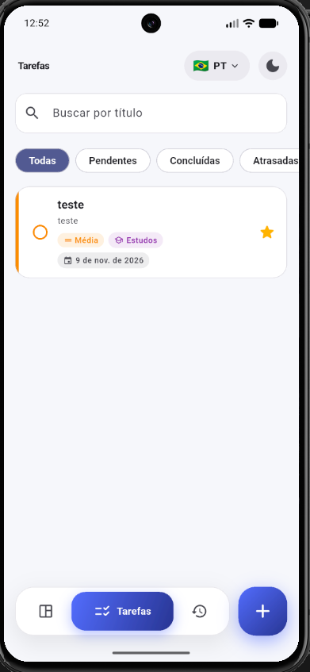
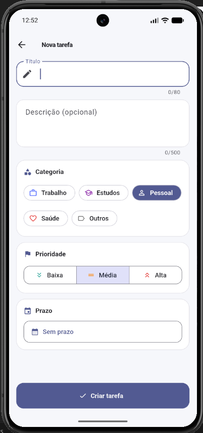
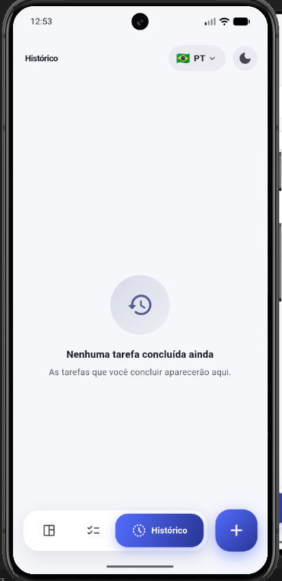

# DevTask

DevTask é um app de gerenciamento de tarefas feito em Flutter. Desenvolvi o projeto para praticar arquitetura em um app completo, com Clean Architecture, MVVM, BLoC, SQLite, injeção de dependência e testes automatizados.

A ideia do app é simples: cadastrar tarefas, organizar por categoria e prioridade, acompanhar prazos e ver o que já foi concluído. O mais importante aqui é a forma como o código foi organizado.

## Prints

| Painel | Tarefas | Nova tarefa | Histórico |
| :---: | :---: | :---: | :---: |
|  |  |  |  |

## Funcionalidades

- Criar, visualizar, editar e excluir tarefas
- Categorias: trabalho, estudos, pessoal, saúde e outros
- Prioridade baixa, média e alta
- Data de prazo, com destaque para tarefas atrasadas
- Favoritar tarefas importantes
- Filtros por pendentes, concluídas, atrasadas e favoritas
- Busca pelo título
- Painel com resumo e estatísticas
- Histórico das tarefas concluídas, agrupadas por dia
- Tema claro e escuro
- Idioma em português (Brasil) e inglês (EUA)
- O idioma e o tema escolhidos ficam salvos
- Splash screen animada
- Dados salvos no próprio aparelho com SQLite

## Como o app funciona

Ao abrir o app aparece a splash. Enquanto a animação roda, as tarefas já estão sendo carregadas do banco. O app só vai para a tela principal quando as duas coisas terminam, então o painel nunca abre vazio.

A tela principal tem três abas, na barra de navegação de baixo:

- **Painel:** mostra uma saudação, a porcentagem de tarefas concluídas, a quantidade de tarefas por situação (total, pendentes, concluídas e atrasadas), a distribuição por categoria e as próximas tarefas. Ao tocar em um dos contadores, o app abre a lista já filtrada.
- **Tarefas:** lista todas as tarefas com campo de busca e filtros. Dá para concluir pelo checkbox, favoritar pela estrela, editar tocando no card e excluir arrastando para o lado.
- **Histórico:** mostra as tarefas concluídas agrupadas pela data de conclusão, com opção de reabrir.

O botão **+** abre o formulário de nova tarefa. No formulário o título é obrigatório; descrição, categoria, prioridade e prazo são opcionais. A mesma tela é usada para editar e para excluir.

No topo ficam os botões para trocar o idioma e o tema. A escolha fica salva e continua valendo quando o app é fechado e aberto de novo.

A lista é ordenada assim: tarefas abertas primeiro, depois as favoritas, depois por prioridade e, por fim, pelo prazo mais próximo.

## Arquitetura

O projeto usa Clean Architecture, separado em três camadas. As dependências apontam sempre para dentro, ou seja, o domínio não depende de nenhuma outra camada.

```
presentation  →  domain  ←  data
(telas, BLoC)    (regras)   (SQLite, preferências)
```

### Domain

É a camada central, escrita em Dart puro, sem Flutter e sem banco de dados.

- **Entidades:** `Task`, `TaskDraft` e `TaskStatistics`, além dos enums de categoria, prioridade e filtro.
- **Casos de uso:** cada regra de negócio é uma classe com uma única responsabilidade: `CreateTask`, `UpdateTask`, `DeleteTask`, `GetTasks`, `ToggleTaskCompletion`, `ToggleFavorite`, `FilterTasks`, `GetTaskStatistics` e `GetCompletedHistory`. As validações (título obrigatório e tamanho máximo) ficam no `TaskValidator`.
- **Contratos:** `TaskRepository` e `SettingsRepository`. O domínio só conhece essas interfaces, não a implementação.

### Data

Implementa os contratos do domínio.

- `SqfliteTaskLocalDataSource` faz as consultas no SQLite.
- `TaskModel` converte uma linha do banco em `Task` e o contrário.
- `TaskRepositoryImpl` usa o data source e transforma erros do banco em exceções da aplicação, para que as outras camadas não precisem conhecer o `sqflite`.
- `SettingsRepositoryImpl` salva o idioma e o tema com `shared_preferences`.

### Presentation

Aqui fica o padrão MVVM, usando o BLoC como ViewModel.

- **View:** as telas e os widgets. Elas só mostram o estado e enviam eventos, sem regra de negócio.
- **ViewModel:** o `TaskBloc` recebe eventos como `TaskCreated`, `TaskCompletionToggled` e `TaskFilterChanged`, chama os casos de uso e emite um novo `TaskState`. O `ThemeCubit` e o `LocaleCubit` cuidam do tema e do idioma.
- **Model:** as entidades e os casos de uso do domínio.

O `TaskState` guarda a lista completa de tarefas e também as listas já calculadas (tarefas visíveis, histórico, próximas e estatísticas). Dessa forma, a tela não precisa filtrar ou contar nada.

Os widgets reutilizáveis, como o card de tarefa e a barra de navegação, recebem apenas dados e callbacks, então não dependem do BLoC.

### Exemplo do fluxo ao concluir uma tarefa

1. O usuário marca o checkbox no card.
2. A tela envia o evento `TaskCompletionToggled` para o `TaskBloc`.
3. O BLoC chama o caso de uso `ToggleTaskCompletion`, que marca a tarefa como concluída e registra a data.
4. O caso de uso salva pelo `TaskRepository`, que atualiza o SQLite.
5. O BLoC recalcula as listas e as estatísticas e emite o novo estado.
6. A tela é redesenhada: a tarefa aparece riscada e vai para o histórico.

### Injeção de dependência

Todas as dependências são registradas com `get_it` em `lib/core/di/injection.dart`. É o único lugar que conhece as classes concretas. Isso facilita trocar implementações e usar mocks nos testes.

### Princípios SOLID

- Cada caso de uso tem uma única responsabilidade.
- O BLoC depende dos casos de uso, e os casos de uso dependem de interfaces, não do SQLite.
- O repositório pode ser trocado sem mexer no domínio. Nos testes, por exemplo, uso um repositório em memória.
- A data atual é injetada por uma interface `Clock`, o que permite testar regras como "tarefa atrasada" com uma data fixa.

### Internacionalização

As traduções ficam em arquivos `.arb` dentro de `lib/core/l10n/arb`, e as classes são geradas com o `gen-l10n` do Flutter. Datas e porcentagens são formatadas de acordo com o idioma.

O domínio não tem nenhum texto. Os erros são códigos, por exemplo `ValidationError.titleRequired`, e a tradução para a mensagem que aparece na tela acontece só na camada de apresentação. Assim, adicionar um novo idioma é só criar um novo arquivo `.arb`.

Depois de alterar uma tradução, é preciso gerar as classes de novo:

```bash
dart run tool/gen_l10n.dart
```

## Tecnologias utilizadas

| Tecnologia | Uso |
| --- | --- |
| Flutter 3.35 / Dart 3.9 | Desenvolvimento do app |
| flutter_bloc | Gerenciamento de estado (Bloc e Cubit) |
| sqflite | Banco de dados local |
| shared_preferences | Salvar idioma e tema |
| get_it | Injeção de dependência |
| equatable | Comparação de objetos por valor |
| flutter_localizations e intl | Tradução e formatação de datas e números |
| flutter_native_splash | Splash nativa |
| flutter_test | Testes unitários e de widget |
| bloc_test | Testes dos BLoCs |
| mocktail | Mocks nos testes |
| sqflite_common_ffi | Rodar o SQLite nos testes sem emulador |


## Testes

O projeto tem **110 testes automatizados**, com cobertura de aproximadamente **95%** das linhas.

| Tipo | O que é testado | Quantidade |
| --- | --- | ---: |
| Regras de negócio | criar, editar, excluir, validar título, tarefa atrasada, filtros, busca, ordenação e estatísticas | 34 |
| Repositórios | conversão de dados, tratamento de erros, CRUD no SQLite e preferências salvas | 20 |
| BLoC e Cubits | eventos e estados com `bloc_test` | 21 |
| Traduções | textos, erros, plurais e datas nos dois idiomas | 5 |
| Widgets | card de tarefa, barra de navegação e formulário | 10 |
| Telas | painel, splash, troca de idioma e layout em telas pequenas | 16 |
| Fluxo completo | uso do app pela interface, do início ao fim | 4 |

Alguns exemplos:

- criar uma tarefa com sucesso;
- impedir uma tarefa sem título;
- atualizar e excluir uma tarefa;
- filtrar tarefas concluídas;
- buscar as tarefas salvas no SQLite;
- verificar os estados emitidos pelo BLoC (`loading`, `ready` e `failure`);
- garantir que o idioma e o tema continuam salvos depois de fechar e abrir o app.

Os testes do SQLite usam um banco em memória com `sqflite_common_ffi`, então rodam direto no computador.

Para rodar:

```bash
flutter test
```

Para gerar a cobertura:

```bash
flutter test --coverage
```

## Como executar

Requisitos: Flutter 3.35 ou superior e um emulador ou celular Android/iOS.

```bash
git clone https://github.com/<seu-usuario>/flutter-devtask-architecture.git
cd flutter-devtask-architecture
flutter pub get
flutter run
```

Se o build do Android falhar com o erro `25.0.4`, o Flutter está usando o Java 25 que vem com o Android Studio. Para resolver, aponte para o JDK 21:

```bash
flutter config --jdk-dir "C:\Program Files\Java\jdk-21"
```

## Próximos passos

- Fazer o mesmo app usando Provider e MobX, mantendo as camadas de domínio e de dados, para comparar as três formas de gerenciar estado
- Configurar o GitHub Actions para rodar a análise e os testes a cada push
